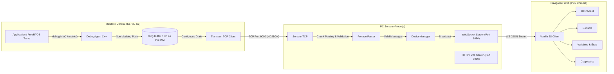
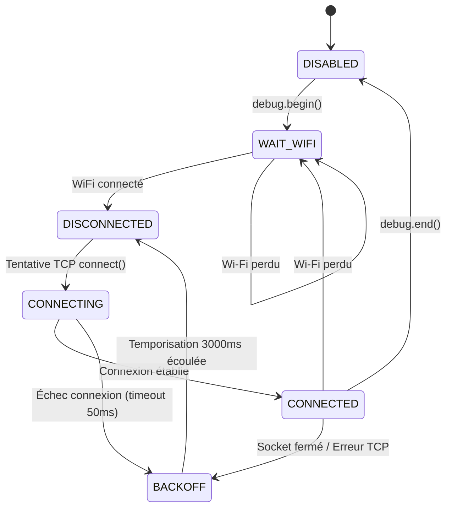

# Architecture Système — CoreS3-DebugMonitor v0.1.0

## 1. Vue d'Ensemble

CoreS3-DebugMonitor est un système distribué de télé-débogage et de métrologie conçu pour l'ESP32-S3 (M5Stack CoreS3) et un PC hôte Windows 11.

---

## 2. Architecture du Firmware (DebugAgent)

### 2.1 Principes Fondamentaux
1. **Zéro allocation dynamique en régime permanent** :
   - Le tampon circulaire (8192 octets) est alloué une seule fois lors de `debug.begin()` en mémoire PSRAM (`MALLOC_CAP_SPIRAM`).
   - Les messages sont formatés directement dans des tampons de pile de taille fixe via `snprintf` / `vsnprintf`.
   - Aucun objet `String` de l'environnement Arduino n'est utilisé dans le chemin critique d'exécution.
2. **Non-bloquant et temps réel garanti** :
   - `debug.update()` s'exécute avec un budget maximal fixe (`DEBUG_UPDATE_BUDGET_US = 200 µs`).
   - Si le tampon est plein, les messages entrants sont abandonnés sans bloquer l'appelant, et le compteur `dropped` est incrémenté.
   - Les sockets réseau ne bloquent jamais la boucle `loop()` du CoreS3.
3. **Sécurité d'accès multi-tâches (FreeRTOS)** :
   - L'accès au pointeur de tête, queue et compteur du tampon circulaire est protégé par un verrou de spinlock très rapide (`portMUX_TYPE`), garantissant une exclusion mutuelle sécurisée entre coeurs et tâches en < 1 µs.
4. **Indépendance totale** :
   - Aucune dépendance à `VoiceKit`, `LVGL` ou `M5Unified`. Seules les interfaces Arduino/ESP-IDF de base sont requises.

### 2.2 Machine à États Réseau du Client TCP

---

## 3. Architecture du Serveur PC (Node.js)

Le serveur PC est conçu sans framework lourd pour une latence minimale et une empreinte mémoire réduite :

1. **Serveur TCP (`tcp-server.js`)** :
   - Écoute sur le port TCP `9000`.
   - Gère les fragments TCP partiels : accumule les flux de données jusqu'au saut de ligne `\n`.
   - Découpe et transmet les lignes NDJSON au validateur de protocole.
   - Protection contre le débordement de ligne : rejette proprement toute ligne dépassant `16 384 octets`.
2. **Validateur de Protocole (`protocol.js`)** :
   - Valide la conformité JSON.
   - Ajoute un horodatage précis de réception côté PC (`rxTime` et `rxMs`).
   - Identifie le type d'événement (`hello`, `log`, `metrics`, `metric`, `state`, `stats`).
3. **Gestionnaire de Sessions & État (`device-manager.js`)** :
   - Maintient l'état du périphérique connecté (identité, métriques actuelles, variables, états).
   - Détecte les paquets perdus en comparant les numéros de séquence (`seq`).
   - Conserve un historique circulaire borné des derniers logs (5000 entrées) et points temporels (120 points).
4. **Passerelle WebSocket (`websocket-server.js`)** :
   - Diffuse en temps réel chaque événement JSON aux navigateurs connectés.
   - Fournit un cliché complet d'initialisation (`init`) à chaque nouveau client Web.

---

## 4. Architecture de l'Interface Web (Vanilla JS)

L'interface Web est développée en JavaScript Vanilla moderne sans React, Vue ou Angular, assurant un chargement instantané (< 100 ms) et 60 FPS constants :

- **Dashboard** : Restitution instantanée des jauges matérielles et tracé Canvas natif pour l'historique SRAM, PSRAM et RSSI.
- **Console** : Rendu incrémental du flux avec filtrage multi-critères, limite stricte de 1000 lignes dans le DOM pour prévenir toute fuite mémoire navigateur.
- **Variables & États** : Tableau dynamique auto-adaptatif reflétant les variables et états sans configuration préalable.
- **Diagnostics** : Métrologie de l'agent et export direct de rapport de diagnostic prêt pour Antigravity.
