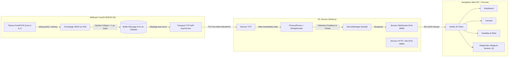
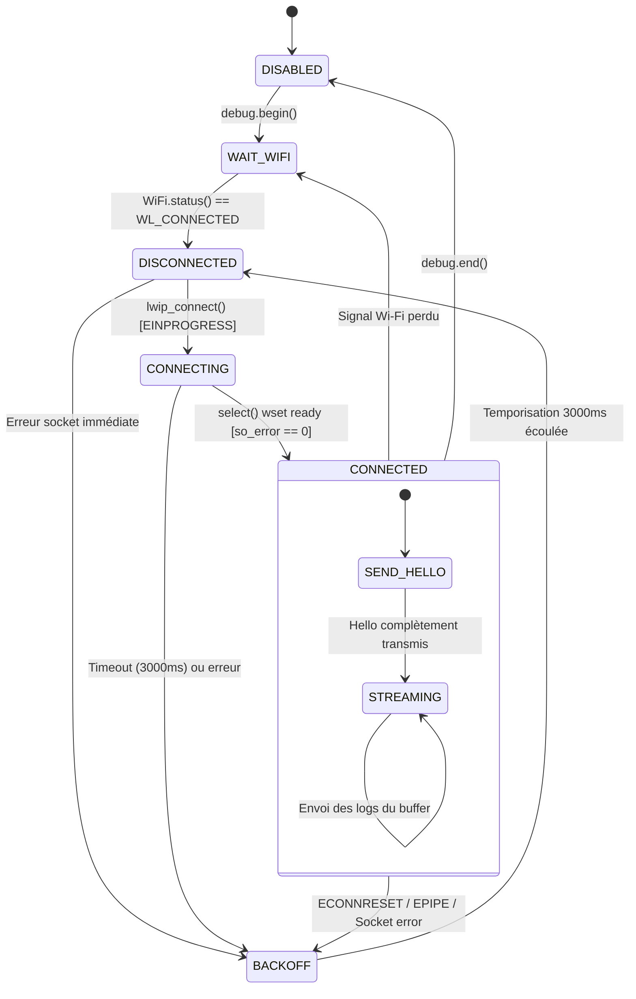

# Architecture Système — CoreS3-DebugMonitor v0.1.0.1
## Non-Blocking & Memory Reliability

---

### 1. Vue d'Ensemble

CoreS3-DebugMonitor est un système distribué de télé-débogage et de métrologie conçu pour l'ESP32-S3 (M5Stack CoreS3) et un PC hôte Windows 11.

---

### 2. Architecture du Firmware (DebugAgent)

#### 2.1 Principes Fondamentaux
1. **Sockets lwIP Natives et Strictement Non-Bloquantes** :
   - Élimination intégrale de `WiFiClient`.
   - Utilisation directe des sockets BSD/lwIP : `socket()`, `fcntl(sock, F_SETFL, O_NONBLOCK)`, `TCP_NODELAY`, `connect()`, `select()`, `send()`, `close()`.
   - Adresses IPv4 numériques uniquement (`inet_pton`) pour éliminer toute résolution DNS synchrone.
   - Surveillance de l'état Wi-Fi sans jamais modifier ni redémarrer la connexion de l'application hôte.
2. **Budget Temporel Coopératif Global** :
   - Budget cible : `#define DEBUG_UPDATE_BUDGET_US 200` (200 µs).
   - Plafond maximal : `#define DEBUG_MAX_UPDATE_US 1000` (1 ms).
   - Découpage par bloc d'écriture (`DEBUG_MAX_CHUNK_WRITE = 512 octets`).
   - Mesure dès l'entrée de `debug.update()` : si le temps est écoulé, les opérations restantes sont reportées à l'appel suivant.
   - Interdiction absolue de `delay()`, d'attente active, ou d'attente bloquante sur socket.
3. **Handshake Isolé & Prioritaire** :
   - Le message `hello` dispose d'un tampon dédié (256 octets).
   - Sous-machine d'états : `CONNECTED` -> `SEND_HELLO` -> `STREAMING`.
   - Gestion des écritures partielles : aucun log n'est transmis avant l'acceptation intégrale du `hello`.
4. **Buffer Circulaire Orienté Messages en PSRAM** :
   - Budget strict de 8192 octets en PSRAM.
   - Format d'enregistrement : `[uint16_t length][NDJSON message]`.
   - Mémorisation de l'offset du message courant en cours d'envoi.
   - Le message n'est définitivement dépilé qu'après son acceptation complète par le socket.
   - En cas de déconnexion inopinée : réinitialisation de l'offset et réémission du message complet après le handshake suivant.
5. **Sécurité Multitâche (FreeRTOS Concurrency)** :
   - Le formatage JSON coûteux (vsnprintf, échappement, conversion UTF-8) s'exécute **hors section critique** sur la pile de la tâche appelante.
   - Seule l'attribution du numéro de séquence `_seq` et l'empilement dans le buffer sont exécutés sous spinlock court (`portMUX_TYPE`, < 1 µs).
   - Garantie que les numéros de séquence reflètent fidèlement l'ordre physique d'insertion.
   - Interdiction formelle de journaliser depuis une ISR matérielle.

#### 2.2 Machine à États Réseau du Transport

---

### 3. Architecture du Serveur PC (Node.js)

1. **Serveur TCP (`tcp-server.js`)** :
   - Écoute sur le port TCP `9000`.
   - Filtre d'entrée : impose un message `hello` valide comme premier paquet sur chaque nouvelle connexion. Rejette toute trame prématurée.
2. **Validateur & Décodeur Protocole (`protocol.js`)** :
   - Utilise `StringDecoder('utf-8')` pour recomposer de manière sûre les caractères UTF-8 multi-octets fragmentés entre plusieurs blocs TCP.
   - Découpage strict des lignes NDJSON et rejet préventif des lignes > 16 384 octets.
3. **Gestionnaire de Sessions & Sessions (`device-manager.js`)** :
   - Maintient l'état des appareils et stocke les sessions par identifiant de démarrage `bootId`.
   - Distingue reconnexion TCP (même `bootId`) et redémarrage matériel (nouveau `bootId`).
   - Détecte et comptabilise les messages dupliqués (`seq <= lastSeq`) et les pertes en transit (`seq > lastSeq + 1`).
   - Génère le rapport de diagnostic standardisé pour Antigravity.
4. **Passerelle WebSocket (`websocket-server.js`)** :
   - Diffuse en temps réel les événements et métriques vers l'interface Web (port 8080).
